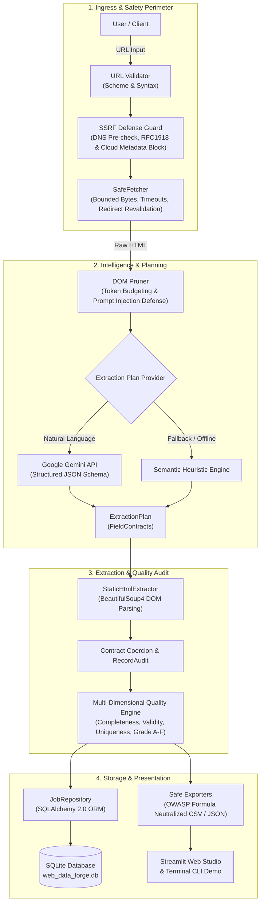
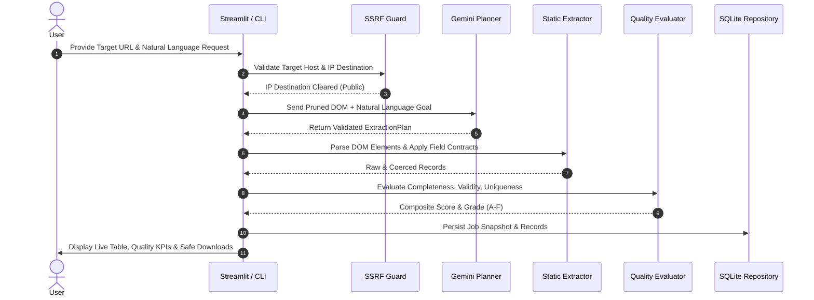

# Web Data Forge

**AI-assisted, configurable web data extraction, validation, and monitoring platform.**

[](https://www.python.org/downloads/)
[](LICENSE)
[-success.svg)](#benchmark-performance--quality-scorecard)
[](#roadmap)

Web Data Forge is an explainable, enterprise-grade data platform that translates natural-language extraction instructions into typed extraction plans, safely inspects targets, executes bounded extraction, validates collected fields against schema contracts, evaluates multi-dimensional data quality, and produces formula-injection-safe CSV/JSON datasets.

---

## Key Features & Differentiators

- **Explainable Pipeline**: Natural language request &rarr; typed schema &rarr; safe source inspection &rarr; extraction adapter &rarr; evidence-backed validation &rarr; exported dataset.
- **Robust Security & SSRF Defenses**: Pre-fetch destination validation blocking loopback (`127.0.0.1`), private RFC1918 networks, link-local, multicast, and cloud metadata endpoints (`169.254.169.254`). Revalidation of all HTTP redirect targets.
- **Ethical Extraction Guardrails**: Respects `robots.txt` crawler guidance and HTTP rate limit signals (`429 Retry-After`). Strict resource boundaries on response bytes, timeouts, and redirect depth. Does not bypass logins, paywalls, or CAPTCHAs.
- **Strict Data Contracts**: Powered by Pydantic v2 schemas. Missing values are explicitly recorded as missing—no hallucinated or fabricated data points.
- **Multi-Dimensional Quality Rubric**: Comprehensive dataset evaluation measuring **Completeness (40%)**, **Validity (40%)**, and **Uniqueness (20%)** with letter grades (**A** through **F**).
- **Safe Serialization**: Neutralizes spreadsheet formula-injection (`=`, `@`, `+`, `-`) in CSV exports while preserving benign numeric literals.
- **Turnkey Persistence**: SQLAlchemy 2.0 ORM with local SQLite storage (`./data/web_data_forge.db`) tracking job histories, telemetry, and record-level audits, ready for PostgreSQL deployment.

---

## System Architecture



### End-to-End Execution Lifecycle



---

## Technology Stack

| Component | Technology | Rationale |
| :--- | :--- | :--- |
| **Language** | Python 3.11+ / 3.12 | Industry standard for data engineering, scraping, and testing. |
| **Data Contracts** | Pydantic v2 | Strictly typed schemas for requests, plans, and extracted records. |
| **Static Extraction** | Requests + BeautifulSoup4 | Fast, deterministic HTML extraction with size & timeout bounds. |
| **AI Planner** | Google Gemini (google-genai SDK) | Natural-language request translation into structured extraction schemas. |
| **Quality Engine** | Native Python + Pydantic | Multi-dimensional scoring (Completeness, Validity, Uniqueness). |
| **Storage Layer** | SQLite + SQLAlchemy 2.0 | Lightweight local persistence transitioning seamlessly to PostgreSQL. |
| **Dashboard UI** | Streamlit | Clean, reactive user interface with strict separation from business logic. |
| **DevOps & CI** | Docker + GitHub Actions | Hardened non-root runtime and automated multi-OS matrix test suite. |

---

## Benchmark Performance & Quality Scorecard

The platform is continuously verified against a comprehensive benchmark corpus spanning 4 standard and adversarial web archetypes:

| Benchmark Archetype | DOM Structure | Records | Latency | Quality Score | Grade | Security & Formula Defense |
| :--- | :--- | :---: | :---: | :---: | :---: | :--- |
| **E-Commerce Catalog** | CSS Cards (`.product-item`) | 6 | ~75 ms | 100.0% | **A** | Verified (types coerced, 0 duplicates) |
| **News Publication** | Semantic Articles (`.news-entry`) | 3 | ~15 ms | 100.0% | **A** | Verified (dates, authors, URLs typed) |
| **Financial Table** | Multi-Column Data (`table tr`) | 4 | ~12 ms | 100.0% | **A** | Verified (float decimals & margins) |
| **Adversarial & Injection** | Broken Tags, Missing Fields | 4 | ~18 ms | 88.3% | **B** | **OWASP Neutralized** (`=`, `@`, `+`, `-` sanitized) |

---

## Project Structure (Modular Monolith)

```
Web-Data-Forge/
├── demo.py                                  # Standalone CLI quickstart demo runner
├── run_app.py                               # Convenience launcher for Streamlit Studio
├── Dockerfile                               # Production hardened, non-root container
├── docker-compose.yml                       # Local container orchestration
├── pyproject.toml                           # Package metadata and pytest configuration
├── requirements.txt                         # Pinned runtime dependencies
├── README.md                                # Comprehensive project documentation
├── .env.example                             # Environment variables template
├── .dockerignore                            # Container build ignore rules
├── .github/
│   └── workflows/
│       └── ci.yml                           # GitHub Actions automated matrix CI
├── src/
│   └── web_data_forge/
│       ├── core/exceptions.py               # Domain error hierarchy
│       ├── security/network_guard.py        # SSRF defense & safe HTTP client
│       ├── inspection/url_validator.py      # Pre-fetch DNS & IP block verification
│       ├── extraction/static_extractor.py   # DOM parsing & CSS selector engine
│       ├── models/contracts.py              # Pydantic v2 schemas & field contracts
│       ├── orchestrator/pipeline.py         # End-to-end pipeline coordinator
│       ├── planner/                         # AI extraction planner (Google Gemini)
│       │   ├── gemini_client.py             # Google GenAI SDK adapter
│       │   ├── dom_pruner.py                # Token budgeting & injection containment
│       │   ├── fallback.py                  # Semantic heuristic fallbacks
│       │   └── planner.py                   # Planner orchestrator
│       ├── quality/evaluator.py             # Multi-dimensional quality scoring rubric
│       ├── storage/                         # SQLAlchemy 2.0 ORM & SQLite repository
│       │   ├── database.py                  # Session management & init_db()
│       │   ├── models.py                    # JobModel & RecordModel schemas
│       │   └── repository.py                # CRUD data access layer
│       ├── export/exporters.py              # OWASP formula-injection-safe CSV/JSON
│       └── ui/app.py                        # Streamlit Studio web application
└── tests/
    ├── conftest.py                          # Pytest fixtures
    ├── unit/                                # Unit test suite (104 tests)
    └── benchmarks/                          # Performance & archetype benchmark tests
```

---

## Getting Started

### 1. Prerequisites
- Python 3.11 or higher
- Git

### 2. Setup Virtual Environment
```bash
# Clone the repository
git clone https://github.com/YOUR_USERNAME/Web-Data-Forge.git
cd Web-Data-Forge

# Create virtual environment
python -m venv .venv

# Activate virtual environment
# Windows (PowerShell):
.venv\Scripts\Activate.ps1
# Linux/macOS:
source .venv/bin/activate
```

### 3. Install Dependencies
```bash
pip install -r requirements.txt
```

### 4. Configure Environment Variables
```bash
cp .env.example .env
# Edit .env and supply your GEMINI_API_KEY when AI planning is enabled
```

### 5. Run the Instant CLI Demo
Experience the full extraction pipeline, quality audit, and safe export in your terminal without any external setup:
```bash
python demo.py
```

### 6. Run the Interactive Web Studio
Launch the Streamlit web interface:
```bash
python run_app.py
```
Open your browser at `http://localhost:8501`.

### 7. Run via Docker Compose (Containerized)
```bash
docker compose up --build
```

### 8. Execute the Test Suite
```bash
pytest -v
```

---

## Security & Ethical Principles

1. **Authorization**: Web Data Forge requires users to have permission to access submitted URLs. Automated tooling does not confer legal authorization.
2. **Untrusted Content**: HTML, scraped text, and metadata are untrusted data. They are never executed, passed directly to shell commands, or used to manipulate AI tool boundaries.
3. **SSRF Controls**: All requests resolve hostnames and verify IP destinations against private and reserved IP blocks prior to socket connection.
4. **No Secret Commitments**: API keys and environment files must never be committed to git.

---

## Roadmap

- [x] **Week 1: Project Foundation** &mdash; Base configuration, skeleton, smoke tests, documentation.
- [x] **Week 2: URL Safety & Static Extraction** &mdash; SSRF defense, Requests/BS4 parser, HTML fixtures.
- [x] **Week 3: Core Orchestrator** &mdash; Pydantic data contracts, pipeline coordination.
- [x] **Week 4: Streamlit UI & Safe Exports (MVP)** &mdash; Form input, results table, CSV/JSON downloads.
- [x] **Week 5: AI Planner** &mdash; Gemini API adapter, structured schema validation, DOM pruner, manual/heuristic fallback.
- [x] **Week 6: Quality & Storage** &mdash; Multi-dimensional quality scoring, SQLite persistence with SQLAlchemy.
- [x] **Week 7: Hardening, CI & Docker** &mdash; Non-root Dockerfile, docker-compose orchestration, GitHub Actions CI matrix.
- [x] **Week 8: Portfolio Polish** &mdash; Architecture & sequence diagrams, benchmark corpus, CLI demo runner, v1.0.0 release.

---

## License
MIT License. See [LICENSE](LICENSE) for details.
